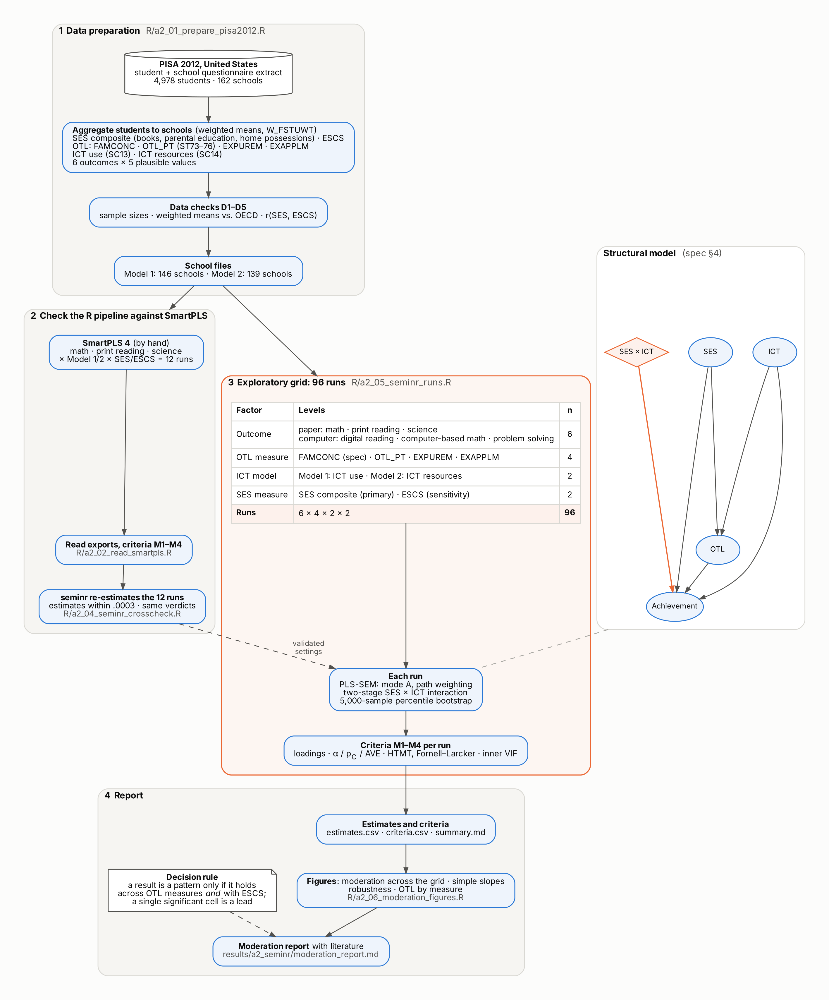
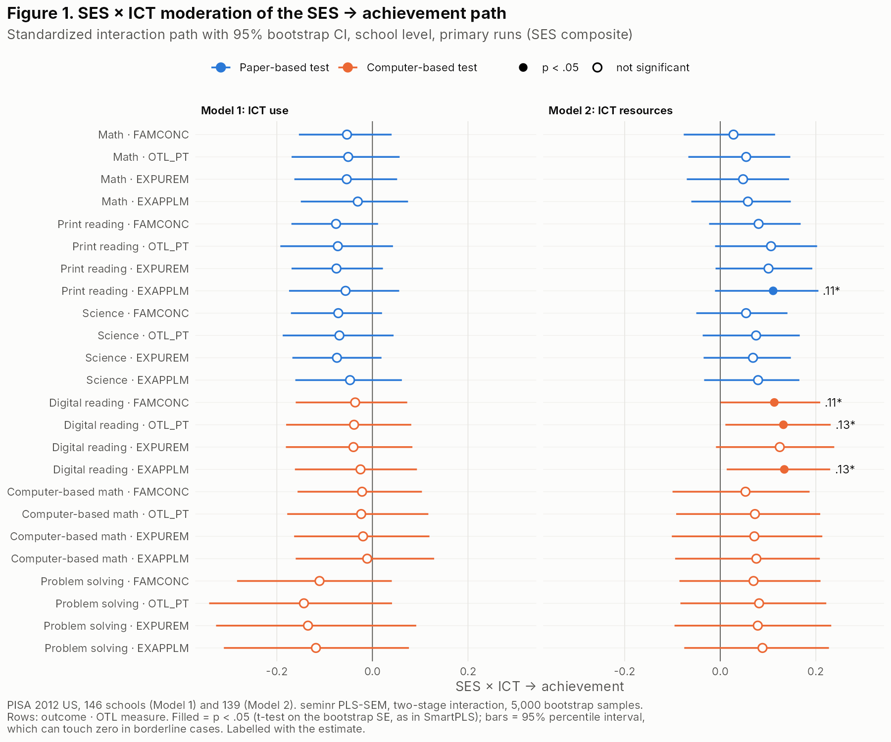

# Opportunity to learn, SES and school ICT in achievement: Zhang and Wang (2020) on TIMSS 2011, and an analogue on PISA 2012

Version 0.1.0 · November 2026 · Qiu Wang and Yue Zhang · A2 (PISA 2012) done; A1 (TIMSS 2011 replication) waits for the data

## Key findings

Zhang and Wang (2020) modelled US Grade 8 mathematics and science achievement in TIMSS 2011 at teacher level. Their model has three parts: content coverage as opportunity to learn (OTL), family socioeconomic status (SES), and in-class computer use (ICT) as a moderator of SES. This project fits an analogue on PISA 2012 for the United States at school level (A2), and will replicate the paper itself (A1).

**Confirmatory (math, OTL = FAMCONC, as specified in [docs/spec.md](docs/spec.md)):**
- **SES dominates in both studies.** SES → math is .53–.55 in PISA (139–146 schools), against .64–.65 in the paper's TIMSS results.
- **OTL matters more in PISA, and depends more on SES.** OTL → math is .37–.38 against .20–.21 in TIMSS. SES → OTL is .52–.61 against .12–.13.
- **No ICT effect on math, and no moderation.** PISA's ICT measures are principal reports on internet use and resources, not classroom computer use, so this is not a like-for-like test of the TIMSS result.
- **The measures pass, and the results reproduce.** Every run meets the pre-set reliability, validity and collinearity criteria. Re-estimating all 12 SmartPLS runs in R (`seminr`) gives the same estimates (within .0003) and the same significance verdicts.

**Exploratory (96 runs: 6 outcomes × 4 OTL measures × 2 ICT models × SES composite or ESCS; [moderation report](results/a2_seminr/moderation_report.md)):**
- **The OTL result depends on the OTL measure.** With FAMCONC (concept familiarity), OTL → achievement is .23–.42. With problem-type exposure (ST73–76), it is .02–.13. The total SES effect is unchanged; only its split between the direct path and the path through OTL moves.
- **ICT use relates to print reading** (total effect .14–.16). This is robust across all four OTL measures and with ESCS.
- **Moderation is borderline and fragile.** School ICT *resources* steepen the SES slope for digital reading (SES × ICT .11–.13, p < .05 in three of four OTL measures). It does not survive ESCS or a false-discovery-rate correction, and power is about 25%.
- **The interaction's sign follows the kind of ICT.** It is positive for resources and negative for use, in every outcome. Individually these estimates are almost all non-significant; together they are a hypothesis, resource multiplication versus substitution, for a better-powered design.

These comparisons are descriptive. The two studies differ in unit (schools vs. teachers), population (15-year-olds vs. Grade 8) and measures; see [What differed](#what-differed).

## Why this project

The paper's TIMSS findings concern US Grade 8 classrooms in one year. Two questions follow: does the same OTL–SES–achievement structure appear in PISA 2012, which measures OTL differently, and does the paper's own analysis reproduce from the public TIMSS data? A2 answers the first. A1 will answer the second and check the pipeline against the published numbers.

## Background

The paper builds on the OTL–SES–performance model of Schmidt et al. (2011, 2015; cited in the paper). SES relates to achievement directly and through OTL. Computer use in class relates to OTL and to achievement, and may moderate the SES–achievement link.

The data are TIMSS 2011, US Grade 8: math 3,398 students and 183 teachers; science 3,989 students and 363 teachers. Only classes whose teachers use computers are included. Student data are aggregated to teacher level.

The model is fitted with factor-based PLS-SEM in WarpPLS 5.0. Model 1 uses the computer as an information tool and Model 2 as a learning tool.

## Design

- **A1 (TIMSS 2011, pending).** The same sample, measures and model as the paper. The paper's 120 reported values are transcribed in [results/paper_zhang_wang_2020.csv](results/paper_zhang_wang_2020.csv). The A1 test checks against them once the tolerances are set.
- **A2 (PISA 2012, done).** US students aggregated to schools, math only. [docs/spec.md](docs/spec.md) records the decisions and the acceptance criteria.
  - SES: books, parent education and home possessions, as in TIMSS. ESCS is a sensitivity check.
  - OTL: FAMCONC.
  - Achievement: 5 plausible values.
  - ICT: use (Model 1) or resources (Model 2).
  - Estimation: PLS-SEM in SmartPLS 4 with 5,000 bootstrap samples, run by the author. Code builds the data and reads the results.
- **A2 R cross-check (done).** `seminr` re-estimates all 12 SmartPLS runs (math, print reading, science × 2 ICT models × SES composite or ESCS) with SmartPLS's settings. Every estimate is within .0003, and every significance verdict is the same.
- **A2 exploratory grid (done).** 96 runs in `seminr`: 6 outcomes × 4 OTL measures × 2 ICT models × 2 SES measures, each with 5,000 bootstrap samples, same schools and same criteria. [docs/spec_exploratory.md](docs/spec_exploratory.md) records the design and how to read it.
  - Outcomes: math, print reading and science (paper-based); digital reading, computer-based math and problem solving (computer-based).
  - OTL: FAMCONC (the spec), `OTL_PT` (ST73–76 problem types), `EXPUREM` and `EXAPPLM` (experience with pure and applied math tasks).
  - A result counts as a pattern only if it holds across OTL measures and with ESCS; a single significant cell is a lead.

*Figure: design and procedure. Source: [docs/figures/design_flowchart.dot](docs/figures/design_flowchart.dot) (Graphviz); also as [SVG](docs/figures/design_flowchart.svg).*

## What differed

| | TIMSS 2011 (paper) | PISA 2012 (A2) |
|---|---|---|
| Unit | Teachers (students aggregated) | Schools (students aggregated; PISA has no teacher link) |
| Population | Grade 8 | 15-year-olds, mostly Grade 10 |
| OTL | Teacher-reported topic coverage this year | Student-reported familiarity with 13 concepts (cumulative) |
| Computer use | Teacher-reported classroom use | Principal-reported internet use for schoolwork (M1) or ICT resources (M2) |
| Subjects | Math and science | Math (spec). Reading and science are exploratory, with math OTL as a proxy: PISA 2012 has no reading or science OTL, and the US skipped the ICT questionnaire |
| Software | WarpPLS 5.0, factor-based PLS | SmartPLS 4, PLS-SEM; `seminr` (R) for the cross-check and the exploratory grid |

One more caution: some paper paths don't follow from its own correlations (e.g. math SES–OTL r = .02, but the path is .12). This suggests WarpPLS's nonlinear algorithm, so an exact A1 match is unlikely.

## Results

A2, math, primary runs (TIMSS values from the paper's Figure 2):

| Path | TIMSS M1 | PISA M1 (ICT use) | TIMSS M2 | PISA M2 (ICT resources) |
|---|---|---|---|---|
| SES → OTL | .12* | .52*** | .13* | .61*** |
| SES → Math | .65** | .53*** | .64** | .55*** |
| OTL → Math | .20** | .37*** | .21** | .38*** |
| ICT → OTL | .29** | .12 | .17** | .00 |
| ICT → Math | .08 | .03 | .08 | −.02 |
| SES × ICT → Math | .04 | −.05 | .03 | .03 |
| R² Math | .50 | .67 | .50 | .69 |

\* p < .05, \*\* p < .01, \*\*\* p < .001. [results/a2/summary.md](results/a2/summary.md) has the full tables: confidence intervals, fit, correlations, the ESCS runs and the criteria.

Reading and science (exploratory) set each subject beside PISA math, with indirect and total effects: [results/a2_reading/summary.md](results/a2_reading/summary.md) and [results/a2_science/summary.md](results/a2_science/summary.md). The science report also has the paper's TIMSS science column.

**Moderation across the exploratory grid.** The SES × ICT path for every outcome and OTL measure, with 95% bootstrap intervals; filled points are p < .05:

[results/a2_seminr/moderation_report.md](results/a2_seminr/moderation_report.md) has the simple slopes, robustness checks, effect sizes and multiple-testing adjustment. It also covers the literature for and against amplification, why most interactions are null, and the theoretical and practical importance. All 96 runs are summarised in [results/a2_seminr/summary.md](results/a2_seminr/summary.md).

## Reproduce

From the repository root, with R 4.3. Packages are pinned in `renv.lock`: haven, readxl, testthat, seminr, ggplot2, ragg. Raw data are not in the repo; [data/README.md](data/README.md) says what the PISA file is, where it goes and how to rebuild it.

| Step | Command | Time | Notes |
|---|---|---|---|
| 0. Packages | `renv::restore()` | minutes | Where CRAN is blocked, see `R/README.md` (apt packages, and `seminr` from GitHub) |
| 1. School-level data | `Rscript R/a2_01_prepare_pisa2012.R` | seconds | Needs `data/raw/pisa2012/user_sav/US_PISA_2012_STSCH.sav`; writes `data/derived/` and data checks D1–D5 |
| 2. SmartPLS models (optional) | SmartPLS 4, by hand | — | [docs/a2_smartpls_steps.md](docs/a2_smartpls_steps.md); exports go in `data/raw/smartpls_exports/` |
| 3. Read SmartPLS results | `Rscript R/a2_02_read_smartpls.R` (math), then `... reading`, `... science` | seconds | Needs step 2's exports; matched to runs by content |
| 4. R cross-check | `Rscript R/a2_04_seminr_crosscheck.R` (math), then `... reading`, `... science` | ~1 min each | Needs step 3's CSVs (committed) |
| 5. Exploratory grid | `Rscript R/a2_05_seminr_runs.R` | ~25 min on 4 cores | 96 runs × 5,000 bootstrap samples; `NBOOT=200` for a quick check |
| 6. Moderation figures and statistics | `Rscript R/a2_06_moderation_figures.R` | ~2 min | Needs step 5 |
| 7. Tests | `Rscript tests/testthat.R` | seconds | 44 pass; 2 skip until A1 and the PISA parity check exist |

## Files

### Start here

This README gives the overview. [results/a2/summary.md](results/a2/summary.md) sets the PISA math results beside the paper's, and [results/a2_seminr/moderation_report.md](results/a2_seminr/moderation_report.md) is the exploratory report. [docs/spec.md](docs/spec.md) records every confirmatory decision, and [docs/spec_exploratory.md](docs/spec_exploratory.md) the exploratory ones.

### Design and decisions

- [docs/spec.md](docs/spec.md): A2 decisions, measures, model, estimation, acceptance criteria and known differences (confirmatory: math, OTL = FAMCONC).
- [docs/spec_exploratory.md](docs/spec_exploratory.md): the exploratory extension, with five more outcomes, three more OTL measures and the 96-run grid.
- [docs/a2_data_audit.md](docs/a2_data_audit.md): the audit of the PISA file against the paper and the variable plan, which led to the measure choices.
- [docs/a2_smartpls_steps.md](docs/a2_smartpls_steps.md): the SmartPLS runs, and the scripted alternative.
- [docs/figures/](docs/figures/): the design flow chart (PNG, SVG and Graphviz source).

### Code

Scripts are in `R/` and run from the repository root; [R/README.md](R/README.md) lists them by role.
- [R/a2_01_prepare_pisa2012.R](R/a2_01_prepare_pisa2012.R) builds the school files and data checks.
- [R/a2_02_read_smartpls.R](R/a2_02_read_smartpls.R) reads the SmartPLS exports for one outcome, checks the criteria and writes the report.
- [R/a2_04_seminr_crosscheck.R](R/a2_04_seminr_crosscheck.R) re-estimates the SmartPLS runs in R and compares them.
- [R/a2_05_seminr_runs.R](R/a2_05_seminr_runs.R) runs the 96-run grid, and [R/a2_06_moderation_figures.R](R/a2_06_moderation_figures.R) makes the moderation figures and statistics.
- [R/a2_seminr_helpers.R](R/a2_seminr_helpers.R) holds the shared model code.
- [R/a2_00_audit_pisa2012.py](R/a2_00_audit_pisa2012.py) is the exploratory audit, in Python.
- Tests are in `tests/testthat/`.

### Results

[results/README.md](results/README.md) indexes the result folders and file conventions.
- `results/a2/` is the confirmatory math analysis.
- `results/a2_reading/` and `results/a2_science/` hold the SmartPLS reading and science runs.
- `results/a2_seminr/` holds the exploratory grid, the moderation report and its figures.

A2 math CSVs and records (11 files)

- **Estimates:**
  - [results/a2/a2_pisa2012_estimates_user_sav.csv](results/a2/a2_pisa2012_estimates_user_sav.csv): primary runs, with SE, p and 95% CI;
  - [results/a2/a2_pisa2012_estimates_sensitivity.csv](results/a2/a2_pisa2012_estimates_sensitivity.csv): ESCS runs.
- **Criteria:**
  - [results/a2/a2_02_criteria.csv](results/a2/a2_02_criteria.csv): model criteria M1–M4 per run;
  - [results/a2/a2_01_checks.csv](results/a2/a2_01_checks.csv): data checks D1–D5.
- **R cross-check:** [results/a2/a2_04_seminr_crosscheck.md](results/a2/a2_04_seminr_crosscheck.md) (report) and [results/a2/a2_04_seminr_vs_smartpls.csv](results/a2/a2_04_seminr_vs_smartpls.csv): seminr vs. SmartPLS, every shared estimate.
- **Data report:** [results/a2/a2_01_pisa2012_school_data.md](results/a2/a2_01_pisa2012_school_data.md): samples, descriptives, correlations, reliabilities, and the OTL measures without FAMCONC.
- **Audit output:** [results/a2/a2_00_pisa2012_data_audit_output.txt](results/a2/a2_00_pisa2012_data_audit_output.txt).
- **Provenance:**
  - [results/a2/data_manifest.csv](results/a2/data_manifest.csv): raw files;
  - [results/a2/a2_02_exports_manifest.csv](results/a2/a2_02_exports_manifest.csv): SmartPLS exports, with SHA-256.

### Published values

[results/paper_zhang_wang_2020.csv](results/paper_zhang_wang_2020.csv) holds the 120 values transcribed from the paper: Tables 2–3, Figure 2 and section 6.2. They are for comparison only, and the paper's PDF is not included.

### Project files

- [LICENSE](LICENSE) (MIT), [CITATION.cff](CITATION.cff) and [.gitignore](.gitignore) (keeps data, PDFs and Word files out).
- `renv.lock` and `renv/`: package versions.
- `from_code/`: the working plan and the session-by-session handoff notes (the project log).

## Status

- **A2 (PISA 2012):**
  - confirmatory math analysis: done;
  - R cross-check: done for math, reading and science;
  - exploratory grid and moderation report: done.
  - Still to do:
    - the parity check against an OECD download (needs OECD access);
    - per-PV pooling and a weighted run (`R/a2_07`);
    - optional PLSc runs.
- **A1 (TIMSS 2011 replication):** waiting for the TIMSS 2011 US Grade 8 files. Tolerances are to be set in the spec, given WarpPLS.
- **Phase B (multilevel model):** after the gate review of A1 and A2. Student-level models with cross-level SES × ICT terms are the natural test of the exploratory moderation (see the report, §3.5).

## Authors

Qiu Wang and Yue Zhang. Questions and issues: please open a GitHub issue.

## AI assistance

The code was written with assistance from Claude Code (Anthropic).

## References

- Becker, J.-M., Ringle, C. M., & Sarstedt, M. (2018). Estimating moderating effects in PLS-SEM and PLSc-SEM: Interaction term generation × data treatment. *Journal of Applied Structural Equation Modeling, 2*(2), 1–21.
- Kock, N., & Hadaya, P. (2018). Minimum sample size estimation in PLS-SEM: The inverse square root and gamma-exponential methods. *Information Systems Journal, 28*(1), 227–261. https://doi.org/10.1111/isj.12131
- OECD. (2013). *PISA 2012 results: What students know and can do (Volume I)*. OECD Publishing. https://doi.org/10.1787/9789264201118-en
- OECD. (2015). *Students, computers and learning: Making the connection*. OECD Publishing. https://doi.org/10.1787/9789264239555-en
- Ray, S., Danks, N. P., & Calero Valdez, A. (2026). *seminr: Building and estimating structural equation models* (Version 2.6.0) [R package]. https://github.com/sem-in-r/seminr
- Ringle, C. M., Wende, S., & Becker, J.-M. (2024). *SmartPLS 4*. SmartPLS. https://www.smartpls.com
- Schmidt, W. H., Burroughs, N. A., Zoido, P., & Houang, R. T. (2015). The role of schooling in perpetuating educational inequality: An international perspective. *Educational Researcher, 44*(7), 371–386. https://doi.org/10.3102/0013189X15603982
- Zhang, Y., & Wang, Q. (2020). Content learning opportunities, computer-based instruction, and students' mathematics and science achievement. *International Journal of Mathematical Education in Science and Technology*. https://doi.org/10.1080/0020739X.2020.1717659

## How to cite

Use the metadata in [CITATION.cff](CITATION.cff) (GitHub's "Cite this repository" button), and please also cite Zhang and Wang (2020). The moderation report has its own reference list.

## License

MIT (see `LICENSE`).
