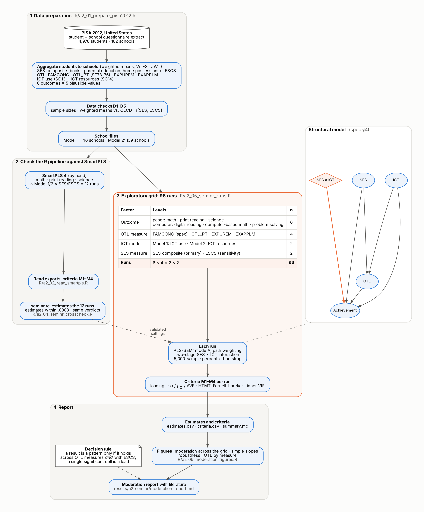
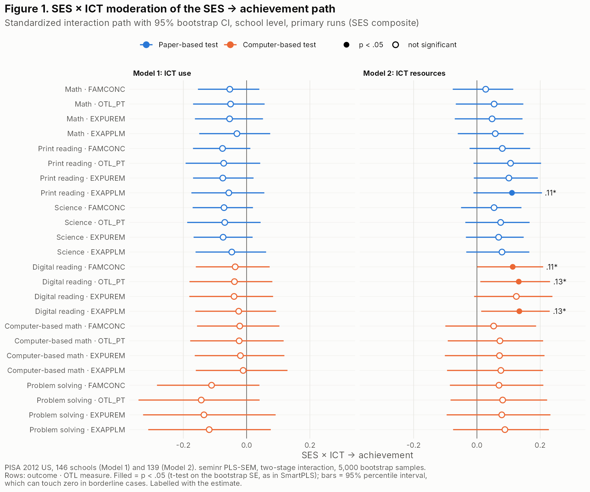
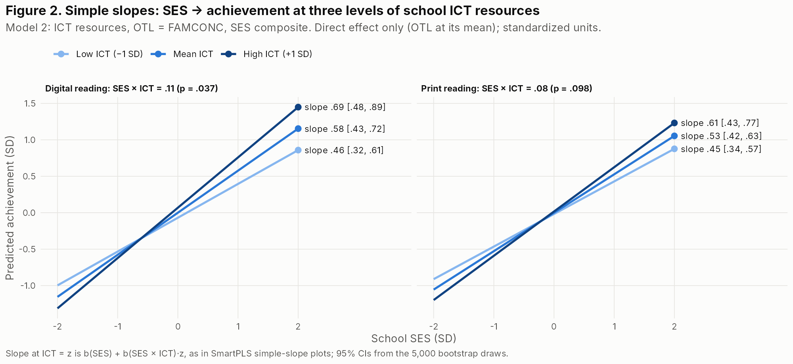
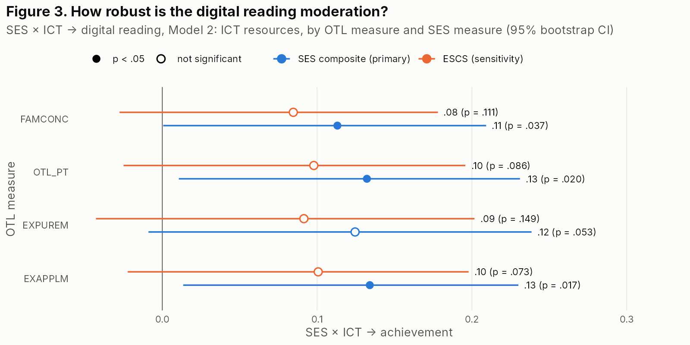
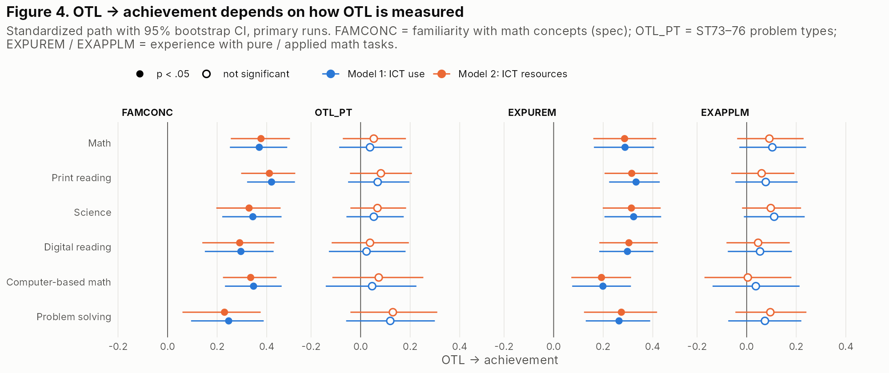

# Does school ICT moderate the SES–achievement link? PISA 2012, United States

Exploratory report, 2026-11-20. Data and code: `R/a2_05_seminr_runs.R` (96 runs), `R/a2_06_moderation_figures.R` (figures, effect sizes, multiple-testing adjustment). Design: `docs/spec_exploratory.md`. All numbers come from `estimates.csv`, `moderation_stats.csv` and `simple_slopes.csv` in this folder.

## Summary

- **One moderation pattern, and it is fragile.** In Model 2 (principal-reported ICT resources), the SES × ICT path on **digital reading** is .11–.13, significant at p < .05 in three of four OTL measures. Its 95% intervals exclude zero, but only just. At one SD above the mean in ICT resources, the SES–digital reading slope is .69; at one SD below, it is .46 (Figure 2).
- **It does not survive the checks.** With ESCS in place of the SES composite, the estimate falls to .08–.10 (p = .07–.15). No moderation survives a false-discovery-rate correction across the 48 interaction tests (smallest adjusted q = .36). At about 140 schools, power to detect a true interaction of .11 is only about 25%. A significant estimate at that power is likely to overstate the true effect.
- **The sign depends on what "ICT" means.** Across all six outcomes and four OTL measures, the interaction is positive for ICT *resources* (24 of 24 cells, .03 to .13) and negative for ICT *use for schoolwork* (24 of 24 cells, −.01 to −.14). Individually the cells are almost all non-significant, and they are not independent. The pattern fits resource multiplication for resources and substitution for use. Treat it as a hypothesis for a better-powered design.
- **The robust ICT result is a main effect, not a moderation.** School ICT use relates to print reading at .14–.16 (total effect), significant under every OTL measure and with ESCS.
- **OTL's role depends on how it is measured (Figure 4).** With FAMCONC, OTL → achievement is .23–.42. With problem-type exposure (ST73–76), it is .02–.13. The total SES effect is unchanged (.57–.80); only its split between the direct path and the path through OTL moves.

*Figure 0. Design and procedure: 6 outcomes × 4 OTL measures × 2 ICT models × 2 SES measures = 96 runs, each with a 5,000-sample bootstrap.*

## 1. Question and design

Zhang and Wang (2020) found, in TIMSS 2011, that using the computer as an information tool moderated the SES–science association (the paper's Model 1: SES × ICT = .09, p < .05). This report asks whether school ICT moderates the SES → achievement path in PISA 2012 for the United States. Two features are new: it covers six outcomes, including three tested on computer, and it tries four ways of measuring opportunity to learn.

- **Unit:** schools, using weighted means of student data. Model 1 (ICT use: the share of lessons, homework and assignments needing the internet) has 146 schools. Model 2 (ICT resources: few shortages of computers, internet and software) has 139.
- **Model:** SES → OTL, ICT → OTL; SES, ICT, OTL and SES × ICT → achievement (spec section 4). PLS-SEM with mode A and path weighting. The interaction uses the two-stage approach (Becker et al., 2018). Bootstrap: 5,000 samples, percentile 95% intervals, p from t with 4,999 df. These are the user's SmartPLS settings, which `R/a2_04` showed `seminr` reproduces (estimates within .0003, same verdicts).
- **Reading a moderation result:**
  - b is the standardized SES × ICT path. A positive b means the SES–achievement slope is steeper in schools with more ICT.
  - f² is the change in R² from adding the interaction, divided by 1 − R².
  - q is the Benjamini–Hochberg adjusted p (Benjamini & Hochberg, 1995).
  - A result counts as a pattern only if it holds across OTL measures *and* with ESCS (`docs/spec_exploratory.md`).

## 2. Results

### 2.1 Measurement

All 96 runs pass the spec's criteria M1–M4 (`criteria.csv`). The lowest ICT loading is .51 (`ICTUSE_LESSON`, kept under the M1 rule because ρC and AVE pass), the largest HTMT is .78, and the largest inner VIF is 1.75.

### 2.2 Where moderation appears

Figure 1 shows all 48 primary interaction estimates. Four reach p < .05, all in Model 2 (ICT resources):

| Outcome | OTL measure | b | p | 95% interval | f² | q (BH, 48 tests) | With ESCS |
|---|---|---|---|---|---|---|---|
| Digital reading | EXAPPLM | .13 | .017 | [.01, .23] | .040 | .36 | .10 (p = .073) |
| Digital reading | OTL_PT | .13 | .020 | [.01, .23] | .039 | .36 | .10 (p = .086) |
| Digital reading | FAMCONC (spec) | .11 | .037 | [.00, .21] | .033 | .36 | .08 (p = .111) |
| Print reading | EXAPPLM | .11 | .043 | [−.01, .21] | .030 | .36 | .05 (n.s.) |
| *Digital reading* | *EXPUREM* | *.12* | *.053* | *[−.01, .24]* | *.042* | *.36* | *.09 (p = .149)* |

The last row is not significant. It is shown because it completes the digital-reading set: the four digital-reading estimates are nearly identical (.11–.13) whichever OTL measure is used.

The direction of the interaction is consistent within each ICT model:

| Model | SES × ICT range across the 24 cells (6 outcomes × 4 OTL measures) | Largest |
|---|---|---|
| Model 1: ICT use | −.01 to −.14, all 24 negative, none significant | problem solving (−.11 to −.14) |
| Model 2: ICT resources | .03 to .13, all 24 positive, 4 significant | digital reading (.11 to .13), then print reading (.08 to .11) |

### 2.3 What the moderation means

Figure 2 shows the simple slopes for the spec's OTL measure, FAMCONC. In schools one SD above the mean on ICT resources, a one-SD difference in school SES goes with a .69 SD difference in digital reading [.48, .89]. In schools one SD below the mean, the difference is .46 [.32, .61]. **Better-equipped schools show a steeper SES gradient in digital reading.** This is a school-level statement: it does not show that individual advantaged students gain more from ICT (Robinson, 1950).

Print reading shows the same shape, but weaker: .61 vs. .45, interaction .08, p = .098. A significant interaction for digital reading next to a non-significant one for print reading is **not** evidence that the two differ (Gelman & Stern, 2006). Their estimates are .11 and .08, with overlapping intervals.

### 2.4 How robust is it?

- **Across OTL measures:** stable, b = .11–.13. Three of four reach p < .05.
- **With ESCS:** smaller (.08–.10), and none reaches p < .05. ESCS adds parental occupation to the TIMSS-style SES composite, and the two correlate .97 at school level, so the drop reflects how close to the threshold the effect sits.
- **Multiple testing:** the 48 primary interaction tests yield q ≥ .36. Even within the 12 FAMCONC tests, q = .39.
- **Power:** by the inverse square root rule (Kock & Hadaya, 2018), about 140 schools detect |β| ≥ .21 with 80% power. For a true β of .11 the power is about 25% two-tailed, and about 510 schools would be needed for 80%.
- **Effect size:** f² = .03–.04 for the digital-reading cells, against a median of .01 across all 48 cells. By Kenny's moderation benchmarks (.005 / .01 / .025) this is large, and far above the median of published moderators, f² ≈ .002 (Aguinis et al., 2005). Those benchmarks come from individual-level data, though. School means remove most within-school noise, which inflates R²-based effect sizes.

**Verdict:** a consistent, borderline, non-robust signal. It is consistent with amplification for digital reading in ICT-rich schools, but it does not establish it.

### 2.5 Other critical results

- **ICT use and print reading (Model 1)** is the most robust ICT finding in the grid. The total effect is .14–.16, p = .011–.023, under all four OTL measures and with ESCS. With FAMCONC as OTL, the total splits into a direct .09 (n.s.) and an indirect part through OTL. With the other OTL measures, the direct path alone is significant (.14–.16).
- **OTL measure (Figure 4).** With FAMCONC, OTL → achievement is .23–.42, and the indirect SES → OTL → achievement effect is .13–.25. With OTL_PT, the corresponding values are .02–.13 and .01–.03. The total SES effect does not move (.57–.80 either way). EXPUREM sits closer to FAMCONC (.19–.33), and EXAPPLM closer to OTL_PT (.00–.11).
- **Computer-based outcomes are explained less well.** With FAMCONC, R² is .40–.63 for the computer-based outcomes and .66–.70 for the paper-based ones (problem solving .40–.41, computer-based math .47–.49, digital reading .60–.63).

## 3. Discussion

### 3.1 Literature consistent with the digital-reading moderation

A steeper SES slope where school ICT resources are better is what **resource multiplication** predicts: a resource yields more for those who already hold other advantages (Ross & Mirowsky, 2006). It is also a school-level form of the **Matthew effect** (Merton, 1968; Stanovich, 1986) and of cumulative advantage (DiPrete & Eirich, 2006). Several lines of work make it plausible specifically for *digital* reading:

- **The second-level digital divide.** Once access is near-universal, inequality moves to skills and uses (Hargittai, 2002; DiMaggio et al., 2004; van Deursen & van Dijk, 2014). Students from resource-rich backgrounds do more "capital-enhancing" activities online (Hargittai & Hinnant, 2008). In PISA 2012, advantaged students more often searched for information or read news online, even where nearly all students had home access (OECD, 2016). Equal school equipment can therefore be converted into unequal gains.
- **SES gaps in digital reading are partly digital-specific.** In PISA 2012, socio-economic differences in print reading only partly account for those in digital reading (OECD, 2015, ch. 5). In 16 European countries, some social-background gaps in digital reading and navigation remained net of print reading (Azzolini & Schizzerotto, 2017, working paper).
- **Digital reading draws on skills beyond print comprehension**, namely navigation, basic computer skills and evaluating online information (Naumann, 2015; Hahnel et al., 2016). These are the skills a well-equipped school with advantaged students is best placed to build.
- **Related amplification findings.** In East Asian PISA 2012 data, ICT use for information retrieval and social interaction could widen SES-based achievement gaps (Chiao & Chiu, 2018). In North Carolina, home computer and broadband access had small negative effects, and universal provision was projected to widen gaps (Vigdor et al., 2014).
- **The original study.** Zhang and Wang (2020) found that computer use moderated the SES–science association in TIMSS 2011. The present grid does not replicate that for science; the science interactions are .05–.08 in Model 2 and negative in Model 1. A related moderation does appear for digital reading, the outcome closest to computer-based work.

### 3.2 Literature that points the other way

The evidence is mixed, and the report should say so.
- A digital-specific reading factor was **less** driven by cultural and economic capital than overall reading in Sweden and Norway (Rasmusson, 2016).
- A review of 23 studies found SES more strongly related to paper than to digital reading (Peras et al., 2023).
- The association between technology use and outcomes does not differ systematically by SES in PISA 2015 (Rodrigues & Biagi, 2017).
- ICT use did not reinforce social differences in PISA 2009 (Biagi & Loi, 2012).
- In Chinese data, ICT use *buffered* the SES–reading link (Xiao & Hu, 2019).
- The SES–ICT literacy correlation is modest, r = .21, and smaller than for mathematics or reading (Scherer & Siddiq, 2019).
- Ross and Mirowsky's own evidence favored substitution over multiplication.

The negative Model 1 interactions, though non-significant, lean the same way. Where principals report more **use** of the internet for schoolwork, the SES slope is flatter, most clearly for problem solving. That is the signature of substitution.

### 3.3 Why moderation is not significant elsewhere

Most of the 48 interaction tests are null. That is the expected outcome of this design and says little about whether the effects are absent.

1. **Power.** Interactions in field data are small: the median f² for published moderators is about .002 (Aguinis et al., 2005), and Kenny's realistic benchmarks are .005 / .01 / .025. Product terms have little residual variance in observational data, because few cases sit at the extremes of both predictors (McClelland & Judd, 1993). With 139–146 schools, only |β| ≥ .21 is reliably detectable (Kock & Hadaya, 2018), and the largest interaction here is .14. When power is this low, the estimates that do reach significance overstate the true effect and can have the wrong sign (Gelman & Carlin, 2014).
2. **Measurement error in the product term.** The product of two imperfectly measured composites is less reliable than either, which lowers power and biases the interaction toward zero (Busemeyer & Jones, 1983; Aiken & West, 1991). ICT is a single principal's report.
3. **The ICT measures miss classroom practice.** PISA asks principals about internet use for schoolwork and resource shortages; TIMSS asked teachers about classroom computer use. Access alone generally does not raise test scores (Escueta et al., 2020). School ICT investment was not linked to better outcomes in PISA 2012 (OECD, 2015). Effects of school computers vanish with controls (Fuchs & Woessmann, 2004). What matters is the quality and kind of use (Petko et al., 2017), and moderate use beats none or heavy use (OECD, 2015; Gubbels et al., 2020). Resource and frequency measures blur these distinctions.
4. **Little variation in access.** Every US school in the sample reports computers. Access gaps had narrowed across countries by 2012 (OECD, 2015), which restricts the range of the moderator.
5. **Paper-based tests demand no ICT skill.** An SES × ICT interaction is least expected for math and science tested on paper, and those are the smallest in Model 2 (.03–.08).
6. **Imputed scores on the computer-based tests.** In the US, only about 19 students per school were sampled for the computer-based assessment. Students not sampled receive plausible values imputed from a conditioning model (Kastberg et al., 2014; OECD, 2015). That this covers digital reading and computer-based math, not only problem solving, is inferred from OECD (2015), not confirmed in the Technical Report. Effects of variables absent from the conditioning model, such as an SES × school-ICT product, are biased toward zero (von Davier et al., 2009; NCES NAEP documentation). This dilutes interactions for exactly the outcomes where they are most expected. The lower R² for computer-based outcomes (.40–.63 vs. .66–.70) fits it, and so does their lower school-level correlation with the paper outcomes (.78–.83, below the student-level .85–.86). Mode effects add further differences (Jerrim, 2016).
7. **TIMSS vs. PISA differences.** These include teacher vs. school level, Grade 8 vs. age 15, teacher-reported topic coverage vs. student-reported familiarity, and classroom vs. principal-reported ICT (spec section 7). The paper's science moderation was estimated on a different unit, population and measure.

### 3.4 Theoretical importance

- **Multiplication or substitution may depend on the kind of ICT.** Resources amplify and use compensates is a falsifiable, two-sided hypothesis. It fits the second-level divide: equal equipment is converted unequally (multiplication), while structured school use can give disadvantaged students practice they lack at home (substitution). Tested against the Ross and Mirowsky (2006, 2011) framework, it moves the question from "does ICT help?" to "which ICT helps whom?".
- **OTL theory depends on how OTL is measured.** In Schmidt et al.'s model, about a third of the SES–literacy relation runs through OTL (Schmidt et al., 2015; Schmidt et al., 2011). That holds here only when OTL is FAMCONC, which carries much of the SES signal (SES → OTL .52–.61). With problem-type exposure (OTL_PT), OTL carries almost none of it (SES → OTL .25–.26; indirect effect .01–.03). Familiarity with concepts, accumulated over years, behaves like a mediator of SES. Exposure to problem types does not. Studies claiming OTL mediation should say which construct they mean, and robustness across OTL measures should be routine.
- **Digital reading as its own outcome.** The moderation, such as it is, appears for digital reading and not for math or science on paper. This supports treating digital reading as more than print reading on a screen (Naumann, 2015; Hahnel et al., 2016).

### 3.5 Practical importance

- **Providing equipment is not an equity policy on its own.** If ICT resources steepen the SES gradient in digital reading, then equipping schools without changing how ICT is used may leave advantaged schools better placed to turn it into digital-literacy gains. OECD (2015) concludes that countries should "improve equity in education first". Access alone does not raise test scores (Escueta et al., 2020).
- **Teach the skills digital reading needs.** Navigation, evaluating online information and basic computer skills predict digital reading over and above print reading (Naumann, 2015; Hahnel et al., 2016). These can be taught explicitly, especially in lower-SES schools.
- **Plan research for interactions.** Detecting school-level interactions of the size seen here needs about 500 schools, or student-level multilevel models with cross-level SES × ICT terms. PISA 2015 and later test every student on computer, which removes the imputation problem in §3.3, point 6. Directional hypotheses should be preregistered, with multiple-testing control and both SES measures reported.
- **Report OTL robustness.** Policy claims that "OTL explains the SES gap" should show results across OTL measures, because the answer changes with the measure.

## 4. Limitations

The data are cross-sectional and observational, and all results are associations at school level (Rutkowski et al., 2010). The analysis uses school means of plausible values, not per-PV pooling, and no sampling weights or replicate variance beyond the student weights used to form school means. Those are planned in `R/a2_07`. All OTL measures concern math. The grid contains many correlated tests. Each comparison across outcomes or OTL measures is descriptive.

## 5. Conclusions

1. School ICT resources show a borderline positive moderation of the SES–digital reading slope (.11–.13), consistent across OTL measures. It is not robust to ESCS or to multiple-testing correction, and the study has low power to confirm it. It is a lead, consistent with the second-level digital divide, and not an established effect.
2. The sign of SES × ICT tracks the kind of ICT: positive for resources and negative for use, in every outcome. This pattern merits a properly powered test.
3. The clearest ICT finding is a main effect: school internet use for schoolwork relates to print reading (≈ .15), robustly.
4. The A2 conclusion that OTL matters more in PISA than in TIMSS holds for FAMCONC but not for problem-type exposure. Opportunity-to-learn findings need to state, and test, the OTL measure.

## References

Only references confirmed against a publisher, DOI, OECD, NCES, ERIC or repository listing are included (search listings, 2026-11-20). Where a DOI did not appear in a listing, the URL of the listing page is given instead.

- Aguinis, H., Beaty, J. C., Boik, R. J., & Pierce, C. A. (2005). Effect size and power in assessing moderating effects of categorical variables using multiple regression: A 30-year review. *Journal of Applied Psychology, 90*(1), 94–107. https://doi.org/10.1037/0021-9010.90.1.94
- Aiken, L. S., & West, S. G. (1991). *Multiple regression: Testing and interpreting interactions*. Sage.
- Azzolini, D., & Schizzerotto, A. (2017). *The second digital divide in Europe: A cross-national study on students' digital reading and navigation skills* (FBK-IRVAPP Working Paper No. 2017-02). https://irvapp.fbk.eu/wp-content/uploads/2017/09/FBK-IRVAPP-Working-Paper-No.-2017-02.pdf
- Becker, J.-M., Ringle, C. M., & Sarstedt, M. (2018). Estimating moderating effects in PLS-SEM and PLSc-SEM: Interaction term generation × data treatment. *Journal of Applied Structural Equation Modeling, 2*(2), 1–21. https://epub.ub.uni-muenchen.de/96102/
- Benjamini, Y., & Hochberg, Y. (1995). Controlling the false discovery rate: A practical and powerful approach to multiple testing. *Journal of the Royal Statistical Society: Series B, 57*(1), 289–300. https://doi.org/10.1111/j.2517-6161.1995.tb02031.x
- Biagi, F., & Loi, M. (2012). *ICT and learning: Results from PISA 2009* (JRC Scientific and Policy Report, EUR 25581 EN). Publications Office of the European Union. https://publications.jrc.ec.europa.eu/repository/bitstream/JRC76061/lbna25581enn.pdf
- Busemeyer, J. R., & Jones, L. E. (1983). Analysis of multiplicative combination rules when the causal variables are measured with error. *Psychological Bulletin, 93*(3), 549–562. https://jbusemey.pages.iu.edu/busemeyerPsychBull1983.pdf
- Chiao, C., & Chiu, C.-H. (2018). The mediating effect of ICT usage on the relationship between students' socioeconomic status and achievement. *The Asia-Pacific Education Researcher, 27*(2), 109–121. https://doi.org/10.1007/s40299-018-0370-9
- DiMaggio, P., Hargittai, E., Celeste, C., & Shafer, S. (2004). Digital inequality: From unequal access to differentiated use. In K. Neckerman (Ed.), *Social inequality* (pp. 355–400). Russell Sage Foundation.
- DiPrete, T. A., & Eirich, G. M. (2006). Cumulative advantage as a mechanism for inequality: A review of theoretical and empirical developments. *Annual Review of Sociology, 32*, 271–297. https://doi.org/10.1146/annurev.soc.32.061604.123127
- Escueta, M., Nickow, A. J., Oreopoulos, P., & Quan, V. (2020). Upgrading education with technology: Insights from experimental research. *Journal of Economic Literature, 58*(4), 897–996. https://doi.org/10.1257/jel.20191507
- Fuchs, T., & Woessmann, L. (2004). Computers and student learning: Bivariate and multivariate evidence on the availability and use of computers at home and at school. *Brussels Economic Review, 47*(3–4), 359–385. https://econpapers.repec.org/RePEc:bxr:bxrceb:y:2004:v:47:i:3-4:p:359-385
- Gelman, A., & Carlin, J. (2014). Beyond power calculations: Assessing Type S (sign) and Type M (magnitude) errors. *Perspectives on Psychological Science, 9*(6), 641–651. https://doi.org/10.1177/1745691614551642
- Gelman, A., & Stern, H. (2006). The difference between "significant" and "not significant" is not itself statistically significant. *The American Statistician, 60*(4), 328–331.
- Gubbels, J., Swart, N. M., & Groen, M. A. (2020). Everything in moderation: ICT and reading performance of Dutch 15-year-olds. *Large-scale Assessments in Education, 8*(1). https://doi.org/10.1186/s40536-020-0079-0
- Hahnel, C., Goldhammer, F., Naumann, J., & Kröhne, U. (2016). Effects of linear reading, basic computer skills, evaluating online information, and navigation on reading digital text. *Computers in Human Behavior, 55*, 486–500. https://doi.org/10.1016/j.chb.2015.09.042
- Hargittai, E. (2002). Second-level digital divide: Differences in people's online skills. *First Monday, 7*(4). https://doi.org/10.5210/fm.v7i4.942
- Hargittai, E., & Hinnant, A. (2008). Digital inequality: Differences in young adults' use of the Internet. *Communication Research, 35*(5), 602–621. https://doi.org/10.1177/0093650208321782
- Jerrim, J. (2016). PISA 2012: How do results for the paper and computer tests compare? *Assessment in Education: Principles, Policy & Practice, 23*(4), 495–518. https://doi.org/10.1080/0969594X.2016.1147420
- Kastberg, D., Roey, S., Lemanski, N., Chan, J. Y., & Murray, G. (2014). *Technical report and user guide for the Program for International Student Assessment (PISA): 2012* (NCES 2014-025). U.S. Department of Education, National Center for Education Statistics. https://nces.ed.gov/pubs2014/2014025.pdf
- Kenny, D. A. (n.d.). *Moderation*. https://davidakenny.net/cm/moderation.htm
- Kock, N., & Hadaya, P. (2018). Minimum sample size estimation in PLS-SEM: The inverse square root and gamma-exponential methods. *Information Systems Journal, 28*(1), 227–261. https://doi.org/10.1111/isj.12131
- McClelland, G. H., & Judd, C. M. (1993). Statistical difficulties of detecting interactions and moderator effects. *Psychological Bulletin, 114*(2), 376–390. https://doi.org/10.1037/0033-2909.114.2.376
- Merton, R. K. (1968). The Matthew effect in science. *Science, 159*(3810), 56–63. https://doi.org/10.1126/science.159.3810.56
- National Center for Education Statistics. (n.d.). *NAEP technical documentation: Summary of procedures, biases of plausible-value statistics*. https://nces.ed.gov/nationsreportcard/tdw/analysis/summary_proced_biases.aspx
- Naumann, J. (2015). A model of online reading engagement: Linking engagement, navigation, and performance in digital reading. *Computers in Human Behavior, 53*, 263–277. https://doi.org/10.1016/j.chb.2015.06.051
- OECD. (2014). *PISA 2012 technical report*. OECD Publishing. https://www.oecd.org/content/dam/oecd/en/about/programmes/edu/pisa/publications/technical-report/PISA-2012-technical-report-final.pdf
- OECD. (2015). *Students, computers and learning: Making the connection*. OECD Publishing. https://doi.org/10.1787/9789264239555-en
- OECD. (2016). Are there differences in how advantaged and disadvantaged students use the Internet? *PISA in Focus*, No. 64. OECD Publishing. https://www.oecd.org/en/publications/are-there-differences-in-how-advantaged-and-disadvantaged-students-use-the-internet_5jlv8zq6hw43-en.html
- Peras, I., Klemenčič Mirazchiyski, E., Japelj Pavešić, B., & Mekiš Recek, Ž. (2023). Digital versus paper reading: A systematic literature review on contemporary gaps according to gender, socioeconomic status, and rurality. *European Journal of Investigation in Health, Psychology and Education, 13*(10), 1986–2005. https://doi.org/10.3390/ejihpe13100142
- Petko, D., Cantieni, A., & Prasse, D. (2017). Perceived quality of educational technology matters: A secondary analysis of students' ICT use, ICT-related attitudes, and PISA 2012 test scores. *Journal of Educational Computing Research, 54*(8), 1070–1091. https://doi.org/10.1177/0735633116649373
- Rasmusson, M. A. (2016). A multilevel analysis of Swedish and Norwegian students' overall and digital reading performance with a focus on equity aspects of education. *Large-scale Assessments in Education, 4*, Article 3. https://doi.org/10.1186/s40536-016-0021-7
- Robinson, W. S. (1950). Ecological correlations and the behavior of individuals. *American Sociological Review, 15*(3), 351–357.
- Rodrigues, M., & Biagi, F. (2017). *Digital technologies and learning outcomes of students from low socio-economic background: An analysis of PISA 2015* (JRC106999, EUR 28688 EN). Publications Office of the European Union. https://doi.org/10.2760/415251
- Ross, C. E., & Mirowsky, J. (2006). Sex differences in the effect of education on depression: Resource multiplication or resource substitution? *Social Science & Medicine, 63*(5), 1400–1413. https://pubmed.ncbi.nlm.nih.gov/16644077/
- Ross, C. E., & Mirowsky, J. (2011). The interaction of personal and parental education on health. *Social Science & Medicine, 72*(4), 591–599. https://pmc.ncbi.nlm.nih.gov/articles/PMC3049298
- Rutkowski, L., Gonzalez, E., Joncas, M., & von Davier, M. (2010). International large-scale assessment data: Issues in secondary analysis and reporting. *Educational Researcher, 39*(2), 142–151. https://doi.org/10.3102/0013189X10363170
- Scherer, R., & Siddiq, F. (2019). The relation between students' socioeconomic status and ICT literacy: Findings from a meta-analysis. *Computers & Education, 138*, 13–32. https://doi.org/10.1016/j.compedu.2019.04.011
- Schmidt, W. H., Burroughs, N. A., Zoido, P., & Houang, R. T. (2015). The role of schooling in perpetuating educational inequality: An international perspective. *Educational Researcher, 44*(7), 371–386. https://doi.org/10.3102/0013189X15603982
- Schmidt, W. H., Cogan, L. S., Houang, R. T., & McKnight, C. C. (2011). Content coverage differences across districts/states: A persisting challenge for U.S. education policy. *American Journal of Education, 117*(3), 399–427. https://doi.org/10.1086/659213
- Stanovich, K. E. (1986). Matthew effects in reading: Some consequences of individual differences in the acquisition of literacy. *Reading Research Quarterly, 21*(4), 360–407. https://doi.org/10.1598/RRQ.21.4.1
- van Deursen, A. J. A. M., & van Dijk, J. A. G. M. (2014). The digital divide shifts to differences in usage. *New Media & Society, 16*(3), 507–526. https://doi.org/10.1177/1461444813487959
- Vigdor, J. L., Ladd, H. F., & Martinez, E. (2014). Scaling the digital divide: Home computer technology and student achievement. *Economic Inquiry, 52*(3), 1103–1119. https://doi.org/10.1111/ecin.12089
- von Davier, M., Gonzalez, E., & Mislevy, R. (2009). What are plausible values and why are they useful? *IERI Monograph Series: Issues and Methodologies in Large-Scale Assessments, 2*, 9–36.
- Xiao, Y., & Hu, J. (2019). The moderation examination of ICT use on the association between Chinese mainland students' socioeconomic status and reading achievement. *International Journal of Emerging Technologies in Learning, 14*(15). https://doi.org/10.3991/ijet.v14i15.10494
- Zhang, Y., & Wang, Q. (2020). Content learning opportunities, computer-based instruction, and students' mathematics and science achievement. *International Journal of Mathematical Education in Science and Technology*. https://doi.org/10.1080/0020739X.2020.1717659
